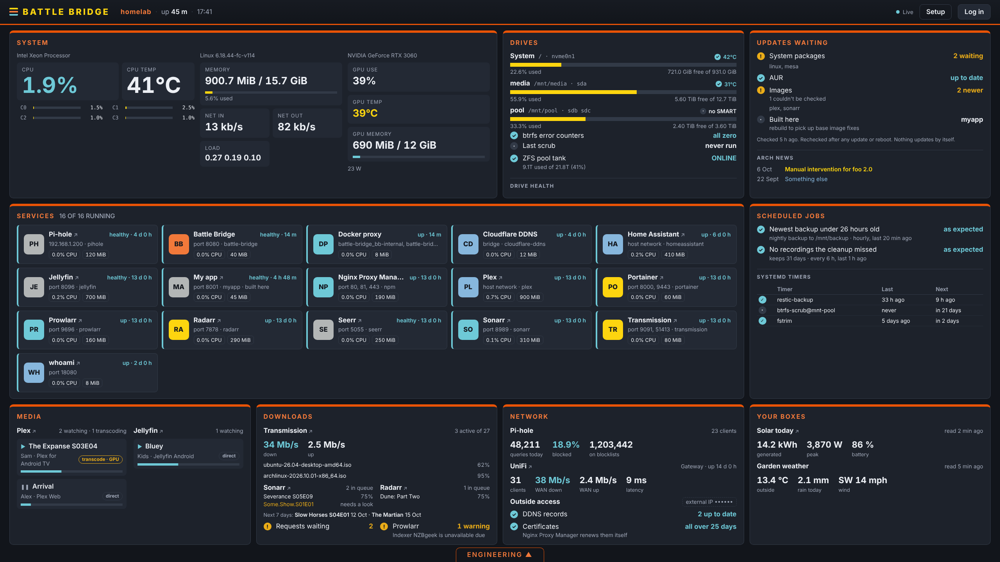

# Battle Bridge

A full-screen dashboard for a Linux home server running Docker.  Live stats,
a tile for every container, what's waiting to update, drive health, and the
everyday jobs as buttons.  Built to stay on your home network.



## What it shows

- **System:** CPU per core, temperature, memory, network, load, and an
  NVIDIA GPU if you have one.  Click any figure for its last 24 hours.
- **Services:** a tile per container, with state, uptime, CPU and memory,
  and a link to its web page.  Links are found for you (see below).
- **Media, downloads and network:** Plex and Jellyfin streams, Sonarr and
  Radarr queues and what's coming, Transmission, Prowlarr, Seerr, Pi-hole,
  a UniFi gateway, Cloudflare DDNS and Nginx Proxy Manager's certificates.
  Each turns on when it's found and given a key.
- **Drives:** space per filesystem, SMART health per disk, btrfs error
  counters and scrubs, ZFS pools.
- **Updates waiting:** system packages (Arch and the AUR, Debian and Ubuntu,
  Fedora), newer container images, a reboot-needed light, and Arch news on
  Arch.
- **Scheduled jobs:** your systemd timers and how they last ended, plus
  outcome checks you write yourself.
- **Your own boxes:** figures from any JSON file or address.

The **Engineering** drawer runs jobs in a live terminal: status, logs,
restart, update one or all (DNS containers last), rebuild, prune, validate
compose files, check for updates, after-reboot checks, and any jobs you add.
Jobs that need sudo (system update, reboot) open a terminal on your Linux
desktop over SSH instead, so your password never goes near the web page.

## Setup

1. On the server, make a folder, download `compose.yml` from the
   [latest release](https://github.com/DanFraserUK/battle-bridge/releases/latest)
   and start it:

   ```bash
   mkdir battle-bridge && cd battle-bridge && curl -fsSLO https://github.com/DanFraserUK/battle-bridge/releases/latest/download/compose.yml && docker compose up -d
   ```

   Want an NVIDIA GPU shown, or its own LAN address?  Uncomment those parts
   of `compose.yml` first.

2. Open `http://<your server's address>:8080`.  The setup page asks for a
   setup code to prove it's you.  Get it with
   `docker logs battle-bridge 2>&1 | grep "setup code"`.  Then set a
   password, add keys for the services it found, and you're done.

3. Optional: the host runner, for jobs, drives, updates and the reboot
   light.  On the server, one command (it asks once before changing
   anything):

   ```bash
   docker cp battle-bridge:/opt/battle-bridge/host ./battle-bridge-host && sudo bash battle-bridge-host/install-runner.sh
   ```

4. Optional: PC jobs.  On the setup page, pick your terminal and SSH login,
   download the link handler, and run it on your PC with
   `bash ~/Downloads/battlebridge-pc-install.sh`.

`docker exec battle-bridge python3 -m battle_bridge check` tries every data
source once and says plainly what works.

To update: `cd battle-bridge && docker compose pull && docker compose up -d`,
then run the step 3 line again if you use the host runner.  To stay on one
version, change `latest` in `compose.yml` to a version such as `1.0.0`.

## How links are found

For each container, in order: a link you type on the setup page, then Docker
labels, then built-in defaults for about fifty common images, then a quick
probe of its ports.  Labels look like this:

```yaml
labels:
  battlebridge.port: "8080"        # the container's own port
  battlebridge.path: "/admin/"
  battlebridge.label: "My app"
  # or the whole thing:  battlebridge.url: "https://{server}:8443/"
  # or no link at all:   battlebridge.link: "none"
  # updated last by "Update all", on its own:  battlebridge.update: "last"
```

The address comes from Docker: the container's own LAN address on a
macvlan network, or the server's address and the published port.

## Your own jobs, checks and boxes

Small TOML files in root-owned folders on the server:
`/etc/battle-bridge/jobs.d`, `checks.d` and `panels.d`.  See
[examples](examples/).

## Safety

- Home network only by default, and only by address.  Requests by hostname
  are refused unless you allow that hostname, which stops DNS rebinding.
- The container never sees the Docker socket.  It reads Docker through a
  read-only proxy that refuses every write.
- The host runner runs only jobs from a fixed list, over a Unix socket only
  the container's group can use.  No shell, no free commands: a job is a
  name, plus at most one compose project or container that Docker itself
  reports.
- Anything needing sudo runs in a terminal on your PC, never in the page.
- One password for every button that changes anything, with a lockout after
  repeated wrong tries.  Keys for other services stay on the server and are
  never sent to the browser.
- A strict Content Security Policy, and nothing loaded from elsewhere.

More in [docs/SECURITY.md](docs/SECURITY.md).

## More

- [docs/NETWORK.md](docs/NETWORK.md): its own LAN address with macvlan
- [docs/TROUBLESHOOTING.md](docs/TROUBLESHOOTING.md): things that have
  caught people out
- [docs/DEVELOPING.md](docs/DEVELOPING.md): tests and the dev server

The layout is made for a 2560x1440 screen, edge to edge.  Smaller screens
get a stacked layout that scrolls.

MIT licence.  xterm.js is included under its own MIT licence.
